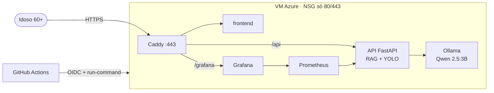
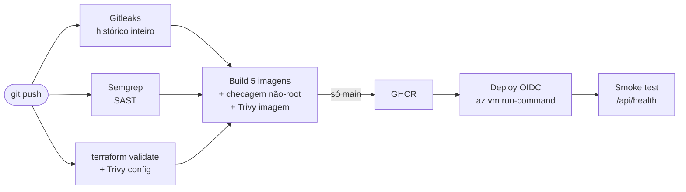

# 🛡️ Golpe Zero — Produção (Deploy Blindado)

**O idoso manda o print ou o texto de uma mensagem suspeita e, em segundos, recebe em linguagem simples (texto e voz) se é golpe, por quê e o que fazer.**

FIAP · Global Solution 2026.2 · CitizenTech · Engenharia de Software 4ES
Disciplina: **Secure DevOps Tools & Cloud Computing** (Prof. Gabriel Arcanjo) · componente **Produção**

[](https://github.com/Autierii/golpe-zero/actions/workflows/devsecops.yml)
[](https://github.com/Autierii/golpe-zero/actions/workflows/infra.yml)

| | |
|---|---|
| 🌐 **MVP no ar** | https://golpezero.northcentralus.cloudapp.azure.com |
| 📊 **Dashboard (sem login, só leitura)** | https://golpezero.northcentralus.cloudapp.azure.com/grafana/ |
| 📘 **API (Swagger)** | https://golpezero.northcentralus.cloudapp.azure.com/docs |
| 🧠 **Repositório de IA (GenAI + Visão)** | https://github.com/rcm2005/golpe-zero-gs |
| 📈 **Repositório de dados (Big Data)** | https://github.com/AllanVI9/golpe-zero-database |

---

## Ficha Técnica do MVP

| Campo | Conteúdo |
|---|---|
| **Nome do produto** | Golpe Zero |
| **Cidadão e território** | Pessoas com 60 anos ou mais e os familiares que cuidam delas. Começa pela cidade de São Paulo |
| **Problema, em uma frase** | Idosos perdem economias em golpes de Pix e WhatsApp porque não conseguem reconhecer sozinhos mensagens e prints fraudulentos, e são os que têm mais dificuldade de recuperar o dinheiro |
| **Proposta de valor** | Análise gratuita em segundos, com veredito (golpe, parece seguro ou não consta), sinais encontrados, fonte oficial e próximo passo. Em voz, com fonte grande e sem guardar o print |
| **Arquitetura: componentes** | Frontend acessível (nginx) · API FastAPI com agente decisor em 2 etapas · RAG em 158 trechos oficiais · YOLOv8n (5 classes) · Ollama Qwen 2.5:3B · Caddy (TLS) · Prometheus e Grafana · VM Azure criada por Terraform · CI/CD GitHub Actions com Gitleaks, Semgrep e Trivy |
| **Fontes de dados** | Cartilhas Febraban, Banco Central (Pix e MED), CERT.br, Procon-SP e SSP-SP · estatísticas SSP-SP e IBGE (pipeline de Big Data) · prints sintéticos anotados (visão) |
| **Modelos de IA utilizados** | Qwen 2.5:3B Instruct (Ollama, 4 bits) · all-MiniLM-L6-v2 (embeddings) · YOLOv8n fine-tuned · Qwen 2.5-0.5B com LoRA (estudo) |
| **URL do MVP e repositório** | https://golpezero.northcentralus.cloudapp.azure.com · https://github.com/Autierii/golpe-zero |
| **Indicadores de impacto** | Prints e mensagens analisados · % classificado como golpe · tempo de resposta (p95) · disponibilidade · usuários 60+ ativos · golpes evitados declarados (os 4 primeiros já estão no dashboard) |
| **ODS conectados** | 10 (redução das desigualdades) · 11 (cidades sustentáveis) · 9 (inovação) · 4 (educação digital) |

### Integrantes

| Nome | RM |
|---|---|
| Levy Nascimento Junior | 98655 |
| Rafael Autieri dos Anjos | 550885 |
| Allan Von Ivanov | 98705 |
| Luiza Cristina Silva | 99367 |
| Rafael Carvalho Mattos | 99874 |

---

## Como a rubrica é atendida

| Critério (14 pts) | Onde está | Evidência |
|---|---|---|
| **Container (2,0):** Dockerfile enxuto, não root, sem segredo, compose | [`api/Dockerfile`](api/Dockerfile) (multi-stage, torch CPU, UID 10001) · [`frontend/Dockerfile`](frontend/Dockerfile) (UID 101) · [`ollama/Dockerfile`](ollama/Dockerfile) (UID 10002) · [`docker-compose.yml`](docker-compose.yml) | O pipeline **falha se a imagem rodar como root** (passo "Confere que a imagem não roda como root"). O Trivy procura segredo dentro da imagem |
| **IaC (3,0):** Terraform, state e .tfvars fora do repo, admin nunca em 0.0.0.0/0 | [`infra/`](infra/) · [`infra/bootstrap/`](infra/bootstrap/) | State num Storage Account (backend `azurerm`, só Entra ID). `*.tfvars` e `*.tfstate` no [`.gitignore`](.gitignore). **NSG sem porta 22/3389**: a administração passa por `az vm run-command` |
| **Pipeline (4,0):** build, Gitleaks, Semgrep, Trivy a cada push, Secrets, deploy automático, execução barrada e corrigida | [`.github/workflows/devsecops.yml`](.github/workflows/devsecops.yml) · [`.github/workflows/infra.yml`](.github/workflows/infra.yml) | IDs da Azure em **GitHub Secrets**, login por **OIDC** (nenhuma senha da nuvem existe). Execução barrada e corrigida em [docs/evidencias](docs/evidencias/) |
| **Observabilidade (3,0):** 4 sinais de ouro e alerta disparado | [`observability/`](observability/) · [`api/src/main.py`](api/src/main.py) | Dashboard com latência, tráfego, erros e saturação. Três alertas provisionados. Disparo com [`scripts/disparar-alerta.sh`](scripts/disparar-alerta.sh) |
| **Documentação (2,0)** | [Arquitetura](docs/arquitetura.md) · [Responsabilidade compartilhada](docs/responsabilidade-compartilhada.md) · [LGPD](docs/lgpd.md) · [Custo](docs/custo.md) | Este README e a seção "Reproduzir do zero" |

---

## Arquitetura (resumo)



O diagrama completo, as decisões e as alternativas descartadas estão em [docs/arquitetura.md](docs/arquitetura.md).

### Pipeline DevSecOps



Qualquer achado de segredo, SAST ou CVE crítica com correção disponível **barra o pipeline**, e nada chega ao cidadão.

---

## Reproduzir do zero

### Rodar local (precisa de Docker)

```bash
cp .env.example .env          # ajuste METRICS_TOKEN e GRAFANA_ADMIN_PASSWORD
docker compose up --build     # https://localhost  (o primeiro start baixa o modelo, ~2 GB)
```

### Colocar na Azure (uma vez)

Pré-requisitos: [Azure CLI](https://learn.microsoft.com/cli/azure/install-azure-cli), [Terraform](https://developer.hashicorp.com/terraform/install) ≥ 1.9, [GitHub CLI](https://cli.github.com/), assinatura Azure for Students.

**1. Bootstrap** (state remoto, RG e identidade OIDC):

```bash
az login
cd infra/bootstrap
cp terraform.tfvars.example terraform.tfvars   # coloque subscription_id e seu e-mail
terraform init && terraform apply
```

**2. Secrets do GitHub** (com os outputs do bootstrap):

```bash
for k in AZURE_CLIENT_ID AZURE_TENANT_ID AZURE_SUBSCRIPTION_ID TFSTATE_STORAGE_ACCOUNT TFSTATE_RESOURCE_GROUP; do
  gh secret set "$k" --env producao --body "$(terraform output -raw $k)"
done
```

**3. Infraestrutura de produção:** rode o workflow **infra** (Actions → infra → Run workflow) ou, localmente:

```bash
cd ../ && cp backend.hcl.example backend.hcl   # nome do storage do passo 1
terraform init -backend-config=backend.hcl && terraform apply
```

**4. Deploy:** qualquer push na `main` roda o **devsecops**, que testa, publica e faz o deploy. O primeiro start do Ollama baixa o modelo (cerca de 5 minutos).

**5. Senha do Grafana (admin):** `terraform -chdir=infra output -raw grafana_admin_password`

### Operação

| Tarefa | Comando |
|---|---|
| Ver os containers | `az vm run-command invoke -g rg-golpezero-prod -n vm-golpezero --command-id RunShellScript --scripts "cd /opt/golpe-zero && docker compose ps"` |
| Gerar tráfego de exemplo | `./scripts/gerar-trafego.sh https://golpezero.northcentralus.cloudapp.azure.com 5` |
| Disparar o alerta (demo) | `./scripts/disparar-alerta.sh https://golpezero.northcentralus.cloudapp.azure.com` |
| Economizar crédito | `az vm deallocate -g rg-golpezero-prod -n vm-golpezero` (para religar: `az vm start ...`) |
| Apagar tudo | `terraform -chdir=infra destroy` e depois `terraform -chdir=infra/bootstrap destroy` |

---

## Estrutura

```
golpe-zero/
├── api/                  # API de GenAI (src/, vision/, base/) + Dockerfile de produção
│   └── src/main.py       # entrada de produção: /metrics e /healthz sobre a API original
├── frontend/             # tela acessível (HTML/CSS/JS puro) + nginx não-root
├── ollama/               # Ollama não-root + download do modelo na primeira subida
├── observability/        # Prometheus e Grafana (dashboard + alertas provisionados)
├── deploy/               # Caddyfile e deploy.sh (roda na VM via run-command)
├── infra/                # Terraform de produção (VNet, NSG, IP, VM) + cloud-init
│   └── bootstrap/        # state remoto, RG, identidade OIDC, budget
├── scripts/              # gerar tráfego, disparar alerta
├── docs/                 # arquitetura, LGPD, custo, responsabilidade, evidências
├── docker-compose.yml    # a mesma stack local e na VM
└── .github/workflows/    # devsecops.yml (app) e infra.yml (Terraform)
```

### Origem do código da API

`api/src`, `api/vision` e `api/base` vêm de [rcm2005/golpe-zero-gs](https://github.com/rcm2005/golpe-zero-gs) (commit `c53eaae`, disciplinas de GenAI e Visão). As mudanças para produção estão marcadas com `[Produção]` ou `[LGPD]` no código:

- endereço e modelo do Ollama por variável de ambiente (antes era `localhost` fixo);
- CORS restrito, porque frontend e API ficam no mesmo domínio (antes era `*` com credenciais);
- o print não é mais gravado em disco e o nome do arquivo não volta na resposta;
- métricas de vereditos e de falhas da LLM, sem dado pessoal.

---

## IA responsável na tela

- O app **nunca diz "100% seguro"**. O melhor veredito é "parece seguro, mas confirme pelo canal oficial".
- Se a API ou a LLM falhar, a tela orienta: **não pague, não clique e ligue para o número do verso do cartão**.
- Quem decide é sempre a pessoa. O aviso fixo diz que o assistente "ajuda, mas não garante 100%".

Licença do código de IA: CC BY-NC-SA 4.0 (herdada do repositório de GenAI).
