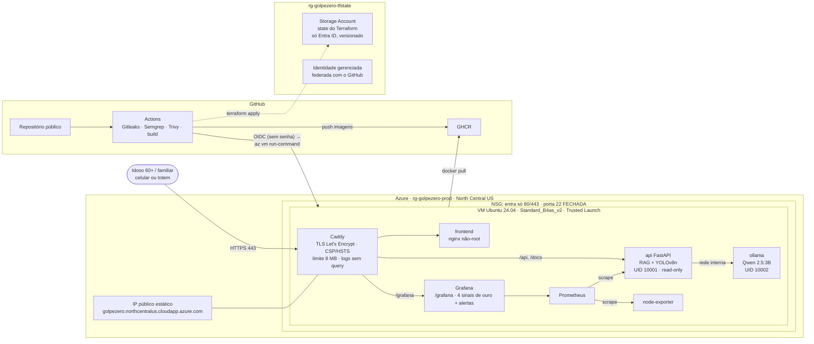

# Arquitetura de produção — Golpe Zero

## Visão geral

## Componentes

| Componente | Imagem | Usuário | Exposição | Papel |
|---|---|---|---|---|
| Caddy | `caddy:2.11.9-alpine` | root com só `NET_BIND_SERVICE` | 80/443 (única entrada) | TLS, cabeçalhos de segurança, roteamento, bloqueio de `/metrics` |
| frontend | `golpe-zero-frontend` (nginx-unprivileged) | 101 | interna | Tela com botão único, fonte grande, voz (Web Speech API) e compressão do print no celular |
| api | `golpe-zero-api` (Python 3.12 slim, multi-stage) | 10001 | interna | API da disciplina de GenAI: agente decisor, RAG em 158 trechos oficiais e YOLOv8n |
| ollama | `golpe-zero-ollama` | 10002 | só rede `interna` | LLM local Qwen 2.5:3B, quantizado em 4 bits |
| prometheus | `golpe-zero-prometheus` | 65534 | interna | Coleta das métricas da API e da VM |
| grafana | `golpe-zero-grafana` | 472 | `/grafana` (só leitura sem login) | Dashboard dos 4 sinais de ouro e alertas |
| node-exporter | `prom/node-exporter` | 65534 | interna | CPU, memória e disco da VM (sinal de saturação) |

Todos os containers rodam com `no-new-privileges` e `cap_drop: ALL`, têm limite de memória e rotação de log. Os que podem rodam com sistema de arquivos `read_only`.

## Fluxo de uma análise

1. O idoso cola o texto ou escolhe a foto. O navegador reduz a imagem para no máximo 1280 px em JPEG 70%, por causa da internet fraca.
2. `POST /api/analisar/texto` ou `/api/analisar/imagem` passa pelo Caddy, com TLS e limite de 8 MB, e chega à API.
3. Etapa 1: portão de domínio e busca vetorial. Fora do domínio, a resposta `nao_consta` sai em cerca de 10 ms, sem chamar a LLM.
4. Etapa 2: os 3 trechos oficiais mais próximos vão para o Qwen 2.5:3B, que devolve JSON com veredito, sinais, fonte e próximo passo.
5. A tela mostra o veredito com cor e lê a resposta em voz alta. O print fica só na memória e não é gravado em disco.

## Por que essas escolhas

| Decisão | Alternativa descartada | Motivo |
|---|---|---|
| VM única com docker compose | AKS ou Container Apps | Custo: o Ollama precisa de 8 GB ou mais de RAM fixa. Um cluster custaria mais que o crédito do Azure for Students. |
| `az vm run-command` para deploy | SSH com chave nos Secrets | Nenhuma porta de administração aberta e nenhuma chave privada guardada. O acesso passa pelo Entra ID e fica auditado no Activity Log. |
| OIDC com identidade gerenciada | Service principal com segredo | Não existe segredo da nuvem para vazar. O token vale só para este repositório, no environment `producao`. |
| Caddy | nginx com certbot | TLS automático e renovação sem cron, numa configuração de cerca de 60 linhas. |
| GHCR | Azure Container Registry | Grátis, e integrado ao `GITHUB_TOKEN`. O ACR Basic custa cerca de US$ 5/mês. |
| North Central US | Brazil South | A política do Azure for Students da FIAP só libera 5 regiões (spaincentral, canadacentral, italynorth, southafricanorth, northcentralus). North Central US é a mais barata delas. Não há dado pessoal persistido, ver [LGPD](lgpd.md). |
